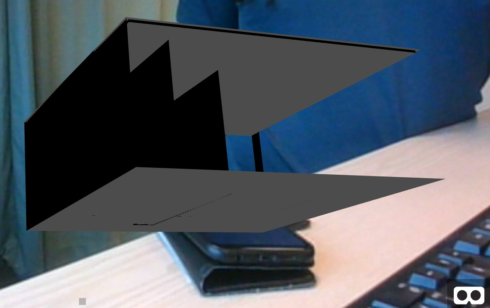

# ArchiAR

Browser-based 3D and marker-AR preview for GLB/GLTF architecture and product models.
No install. No account. Shareable URL.



**Live:** <https://dnzengou.github.io/aframe-archi3d/>

## What it does

- **3D preview** — drag to rotate on desktop, tilt your phone on mobile.
- **Marker AR** — point your camera at a [Hiro marker](https://stemkoski.github.io/AR-Examples/markers/hiro.png) to anchor the model in the real world.
- **Bring your own model** — append `?model=HTTPS_URL_TO_GLB` to the URL (CORS required).
- **AI companion** — a lightweight, private, rule-based guide that walks first-timers through the three steps.

## Share your own model

```
https://dnzengou.github.io/aframe-archi3d/?model=https://your-cdn.example.com/chair.glb
```

Start directly in AR:

```
https://dnzengou.github.io/aframe-archi3d/?model=https://your-cdn.example.com/chair.glb&mode=ar
```

## Shortcuts

| Key | Action |
|-----|--------|
| `M` | Toggle 3D ↔ AR |
| `R` | Reset view |
| `H` or `?` | Open onboarding |

## Run locally

Any static server works:

```bash
python -m http.server 8080
# or
npx serve .
```

Then open <http://localhost:8080>. For AR on a phone, use HTTPS (e.g. via `ngrok http 8080`).

## Agent-ready / GEO

Machine-readable discovery files ship in the root:

- [`llms.txt`](./llms.txt) — plain-text summary for LLM crawlers.
- [`agents.json`](./agents.json) — action schema so an agent can compose a preview URL.
- [`robots.txt`](./robots.txt) — explicit opt-in for AI crawlers.
- Embedded `Schema.org` `SoftwareApplication`, `3DModel`, and `FAQPage` JSON-LD.

## Built with

- [A-Frame](https://aframe.io) 1.5
- [AR.js](https://github.com/AR-js-org/AR.js) 3.4

## Commercial

Need a branded, client-ready viewer, WebXR showroom, or product configurator?
Book a fixed-scope sprint at [desiredsolutions.me](https://desiredsolutions.me).

## License

Code: MIT. Bundled demo asset: CC BY 4.0.
